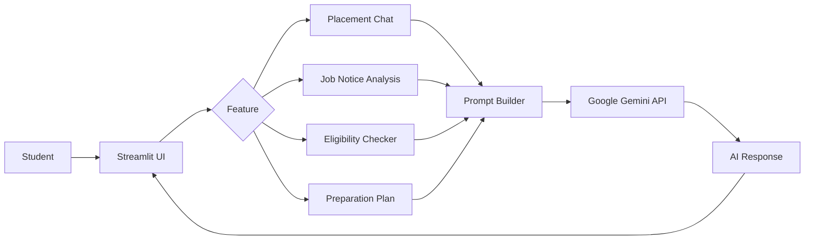

<div align="center">

# 🎓 CampusPath AI

### AI-powered College Placement Assistant

Placement guidance, job notice analysis, eligibility checks, and personalized preparation plans, all in one conversational app.

[](YOUR_DEPLOYED_APP_URL)


</div>

---

## 📖 Table of Contents

- [Overview](#-overview)
- [The Problem](#-the-problem)
- [Features](#-features)
- [How It Works](#-how-it-works)
- [Tech Stack](#-tech-stack)
- [Getting Started](#-getting-started)
- [Configuration](#-configuration)
- [Project Structure](#-project-structure)
- [Deployment](#-deployment)
- [Roadmap](#-roadmap)
- [Disclaimer](#-disclaimer)
- [Author](#-author)

---

## 🔍 Overview

**CampusPath AI** is a web application that helps students prepare for campus recruitment. It combines a conversational AI interface, powered by the **Google Gemini API**, with focused tools that answer the questions students ask most during placement season:

- *What does this job notice actually require?*
- *Am I eligible for this role?*
- *What should I study, and in what order?*

The app is built with **Python** and **Streamlit**, and is deployed on **Streamlit Community Cloud**.

---

## 🎯 The Problem

Placement season is stressful. Students often face:

| Challenge | How CampusPath AI helps |
|---|---|
| Long, dense job notices that are hard to interpret | Breaks them down into clear role requirements |
| Unclear eligibility criteria (CGPA, branch, backlogs, etc.) | Checks a student's profile against the criteria |
| No structured preparation path | Generates a step-by-step preparation plan |
| Limited access to personalized mentoring | Provides on-demand AI guidance |

---

## ✨ Features

- 💬 **Placement Chat**
  Ask placement and career-preparation questions and get conversational, AI-generated guidance.

- 📄 **Job Notice Analysis**
  Paste a job description or notice and get the key role requirements identified and summarized.

- ✅ **Eligibility Checker**
  Compare your details against the criteria provided in a job notice to see where you stand.

- 🗓️ **Preparation Plan**
  Generate a structured plan to prepare for placements based on your goals.

- 🤖 **Gemini-Powered Responses**
  All responses are generated through the Google Gemini API.

---

## ⚙️ How It Works



1. The student picks a feature in the Streamlit interface and provides input (a question, a job notice, or their details).
2. The app turns that input into a structured prompt for the task.
3. The prompt is sent to the **Gemini API**.
4. The generated response is displayed back in the UI.

---

## 🧰 Tech Stack

| Layer | Technology |
|---|---|
| Language | Python |
| Frontend / App Framework | Streamlit |
| AI Model | Google Gemini API |
| Hosting | Streamlit Community Cloud |

---

## 🚀 Getting Started

### Prerequisites

- Python 3.9 or higher
- A Google Gemini API key ([get one here](https://aistudio.google.com/app/apikey))
- Git

### Installation

**1. Clone the repository**

```bash
git clone YOUR_GITHUB_REPOSITORY_URL
cd CampusPath-AI
```

**2. Create and activate a virtual environment**

```bash
python -m venv .venv
```

<details>
<summary><b>Windows (PowerShell)</b></summary>

```powershell
.venv\Scripts\Activate.ps1
```

</details>

<details>
<summary><b>macOS / Linux</b></summary>

```bash
source .venv/bin/activate
```

</details>

**3. Install dependencies**

```bash
pip install -r requirements.txt
```

**4. Add your API key** (see [Configuration](#-configuration))

**5. Run the app**

```bash
streamlit run app.py
```

The app will open at `http://localhost:8501`.

---

## 🔐 Configuration

CampusPath AI reads the Gemini API key from **Streamlit secrets**. Create the file `.streamlit/secrets.toml` in the project root:

```toml
GEMINI_API_KEY = "YOUR_GEMINI_API_KEY"
```

> [!WARNING]
> Never commit `secrets.toml` or expose your API key publicly. Make sure `.streamlit/secrets.toml` is listed in your `.gitignore`.

---

## 📁 Project Structure

```text
CampusPath-AI/
├── app.py              # Main Streamlit application
├── requirements.txt    # Python dependencies
└── README.md           # Project documentation
```

---

## ☁️ Deployment

CampusPath AI is deployed on **Streamlit Community Cloud**.

To deploy your own copy:

1. Push the repository to GitHub.
2. Sign in to [Streamlit Community Cloud](https://streamlit.io/cloud) and create a new app from the repository.
3. Set `app.py` as the main file.
4. Under **Advanced settings → Secrets**, add:
   ```toml
   GEMINI_API_KEY = "YOUR_GEMINI_API_KEY"
   ```
5. Click **Deploy**.

---

## 🛣️ Roadmap

Ideas for future improvements:

- [ ] Resume analysis and feedback
- [ ] Mock interview practice
- [ ] Company-specific preparation guides
- [ ] Saved chat history and progress tracking
- [ ] Multi-language support

---

## ⚠️ Disclaimer

CampusPath AI provides **informational support** for placement preparation. AI-generated responses may contain errors. Always verify job requirements, eligibility criteria, and recruitment details with the official employer or your college placement office.

---

## 👤 Author

**Saiprasad Godge**
Computer Science and Engineering Student

[](YOUR_GITHUB_PROFILE_URL)
[](YOUR_LINKEDIN_URL)

---

<div align="center">

If you found this project useful, consider giving it a ⭐

</div>
