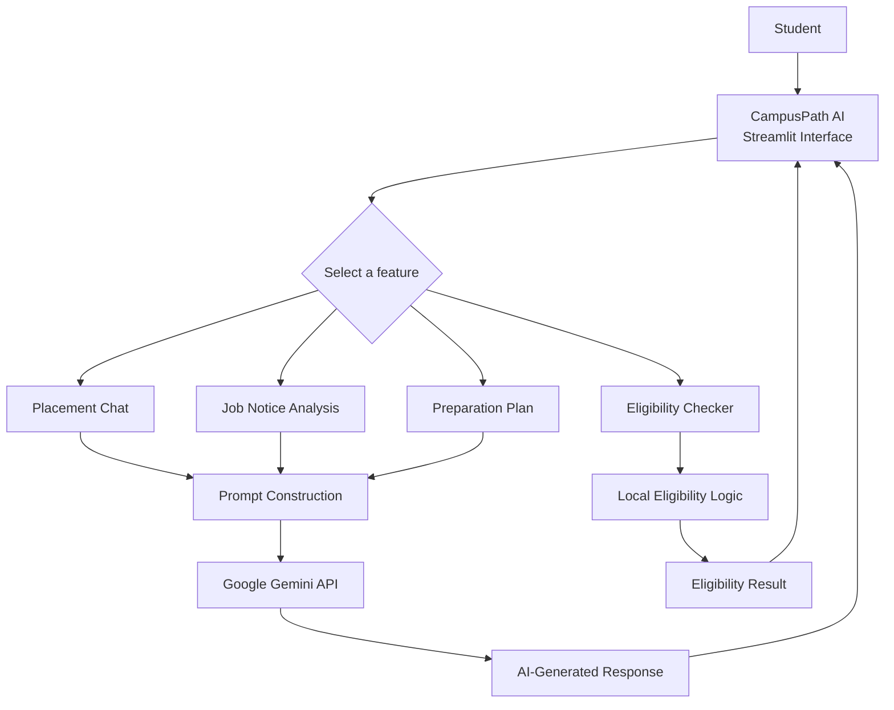

<div align="center">

# CampusPath AI

### AI College Placement Assistant

**Navigate placement preparation with more clarity.**

An AI-powered assistant for placement guidance, job notice analysis, eligibility checks, and structured preparation planning.

<br/>

[](YOUR_DEPLOYED_APP_URL)
[](YOUR_GITHUB_REPOSITORY_URL)

<br/>


</div>

---

## Overview

CampusPath AI brings essential placement-preparation tools into one accessible web application. Students can ask career-related questions, understand job requirements, compare their details with stated eligibility criteria, and create a focused preparation plan.

The application combines a Streamlit interface with the Google Gemini API for AI-powered assistance.

## At a Glance

| | |
|---|---|
| **Purpose** | Support students during campus placement preparation |
| **Interface** | Streamlit web application |
| **AI integration** | Google Gemini API |
| **Deployment** | Streamlit Community Cloud |

## Features

<table>
<tr>
<td width="50%" valign="top">

### Placement Chat

Ask placement and career-preparation questions and receive conversational guidance.

</td>
<td width="50%" valign="top">

### Job Notice Analysis

Review a job notice and identify its key requirements, skills, and role details.

</td>
</tr>
<tr>
<td width="50%" valign="top">

### Eligibility Checker

Compare provided student details with the eligibility criteria stated in a job notice.

</td>
<td width="50%" valign="top">

### Preparation Plan

Create a structured plan to help organize placement preparation.

</td>
</tr>
</table>

## Application Architecture



The app receives user input through Streamlit and routes it to the selected feature. AI-supported tasks use the Gemini API, while the eligibility checker evaluates the provided details against the supplied criteria locally.

## Technology Stack

| Technology | Role in the project |
|---|---|
| **Python** | Application logic |
| **Streamlit** | Interactive web interface |
| **Google Gemini API** | AI-powered assistance and analysis |
| **Streamlit Community Cloud** | Application hosting |

## Try the Application

**[Launch CampusPath AI →](YOUR_DEPLOYED_APP_URL)**

Open the live application to explore its placement-preparation tools.

## Run Locally

### Prerequisites

- Python 3.9 or later
- Git
- A Google Gemini API key

### 1. Clone the repository

```bash
git clone YOUR_GITHUB_REPOSITORY_URL
cd CampusPath-AI
```

### 2. Create a virtual environment

```bash
python -m venv .venv
```

Activate it:

<details>
<summary><strong>Windows PowerShell</strong></summary>

```powershell
.venv\Scripts\Activate.ps1
```

</details>

<details>
<summary><strong>macOS / Linux</strong></summary>

```bash
source .venv/bin/activate
```

</details>

### 3. Install dependencies

```bash
pip install -r requirements.txt
```

### 4. Configure the Gemini API key

Create `.streamlit/secrets.toml` in the project directory:

```toml
GEMINI_API_KEY = "YOUR_GEMINI_API_KEY"
```

Keep this file private. Do not commit API keys or other secrets to GitHub.

### 5. Start the application

```bash
streamlit run app.py
```

Streamlit will print the local address in your terminal.

## Deployment

CampusPath AI is deployed on **Streamlit Community Cloud**.

To deploy your own copy:

1. Push the project to a GitHub repository.
2. Create an app in Streamlit Community Cloud and select the repository.
3. Set the main file path to `app.py`.
4. Add your Gemini API key under the app's **Advanced settings → Secrets**.
5. Deploy the application.

## Project Structure

```text
CampusPath-AI/
├── app.py
├── requirements.txt
└── README.md
```

This shows the core files. Add any other files or folders that are present in your repository.

## Responsible Use

CampusPath AI is intended to support placement preparation. AI-generated guidance may be incomplete or incorrect. Verify job details, eligibility criteria, and recruitment information with the official employer or college placement office.

## Author

**Saiprasad Godge**  
Computer Science and Engineering

[GitHub](YOUR_GITHUB_PROFILE_URL) · [LinkedIn](YOUR_LINKEDIN_URL)

---

<div align="center">

Built to make placement preparation more organized and accessible.

</div>
