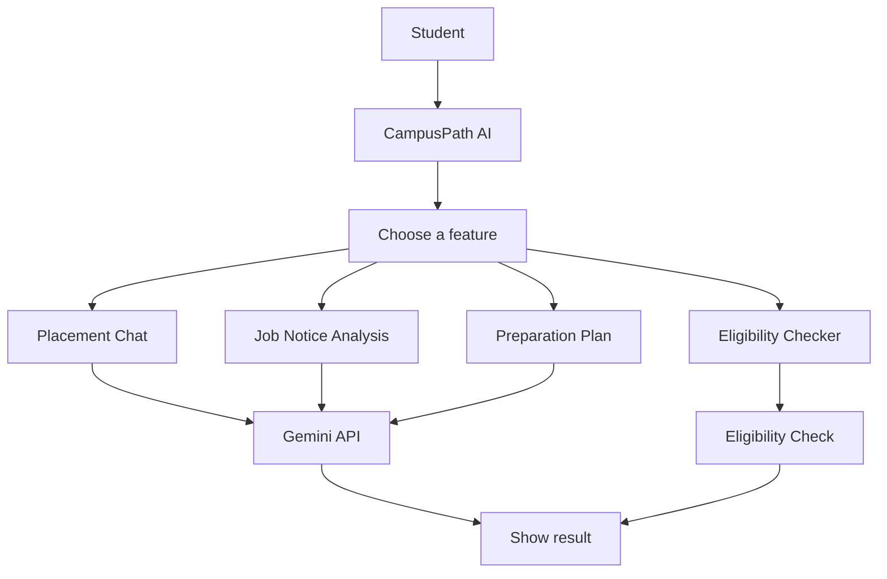

<div align="center">

# CampusPath AI

### AI College Placement Assistant

A simple AI assistant that helps students prepare for campus placements.

[](https://campuspath-ai.streamlit.app/)
[](https://github.com/SAI-GODGE/CampusPath-AI)


</div>

---

## About the Project

CampusPath AI brings useful placement-preparation tools into one app. Students can ask career questions, understand job notices, check eligibility, and create a study plan.

The app is built with Python and Streamlit, and uses the Google Gemini API for AI-powered help.

## What It Can Do

- **Placement Chat:** Ask questions about placements and career preparation.
- **Job Notice Analysis:** Find the main skills and requirements in a job notice.
- **Eligibility Checker:** Compare your details with the requirements listed for a job.
- **Preparation Plan:** Create a plan to help you prepare for placements.

## How It Works



The student selects a feature and enters information. CampusPath AI processes it and shows a response or result.

## Technology Used

| Technology | What it does |
|---|---|
| Python | Runs the app logic |
| Streamlit | Builds the web interface |
| Google Gemini API | Provides AI-powered responses |
| Streamlit Community Cloud | Hosts the live app |

## Try It

**[Open CampusPath AI →](YOUR_DEPLOYED_APP_URL)**

## Run It on Your Computer

### 1. Clone the repository

```bash
git clone YOUR_GITHUB_REPOSITORY_URL
cd CampusPath-AI
```

### 2. Create a virtual environment

```bash
python -m venv .venv
```

Activate it:

**Windows PowerShell**
```powershell
.venv\Scripts\Activate.ps1
```

**macOS / Linux**
```bash
source .venv/bin/activate
```

### 3. Install the required packages

```bash
pip install -r requirements.txt
```

### 4. Add your Gemini API key

Create `.streamlit/secrets.toml` and add:

```toml
GEMINI_API_KEY = "YOUR_GEMINI_API_KEY"
```

Keep your API key private. Do not upload this file to GitHub.

### 5. Start the app

```bash
streamlit run app.py
```

## Project Files

```text
CampusPath-AI/
├── app.py
├── requirements.txt
└── README.md
```

## Deployment

CampusPath AI is hosted on Streamlit Community Cloud. Open the live app using the link at the top of this page.

## Note

This app is meant to help with placement preparation. Always confirm job requirements and eligibility details with the official employer or your college placement office.

## Author

**Saiprasad Godge**  
Computer Science and Engineering

[GitHub](YOUR_GITHUB_PROFILE_URL) · [LinkedIn](YOUR_LINKEDIN_URL)

